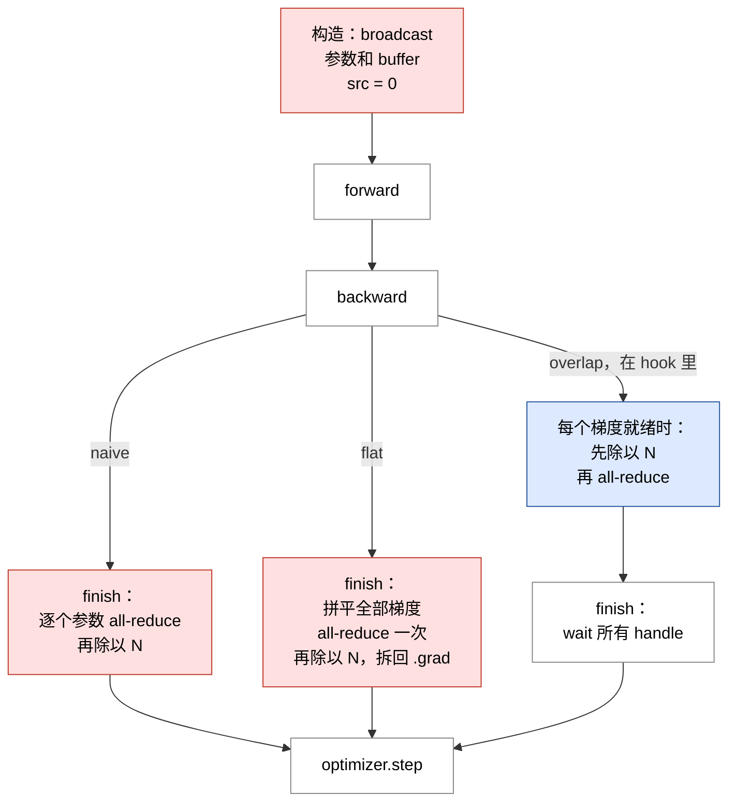
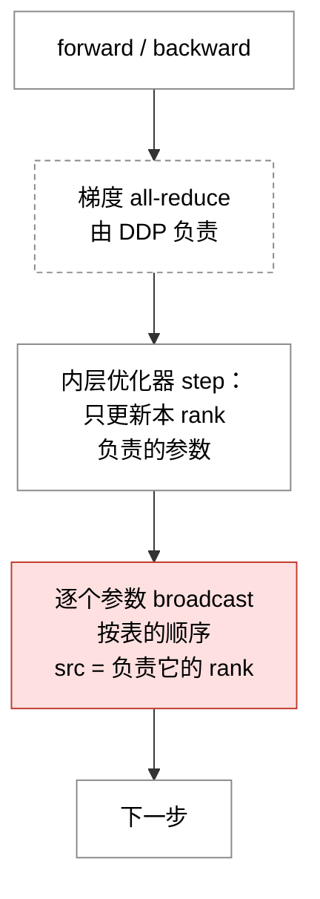
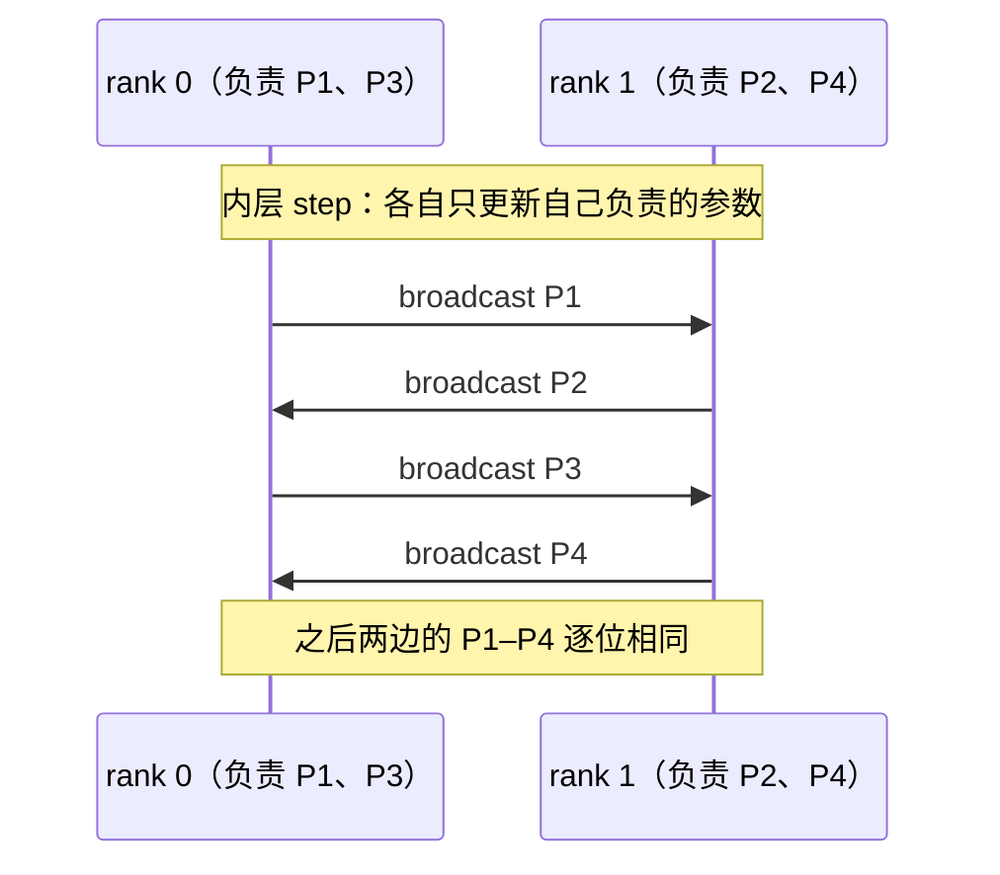
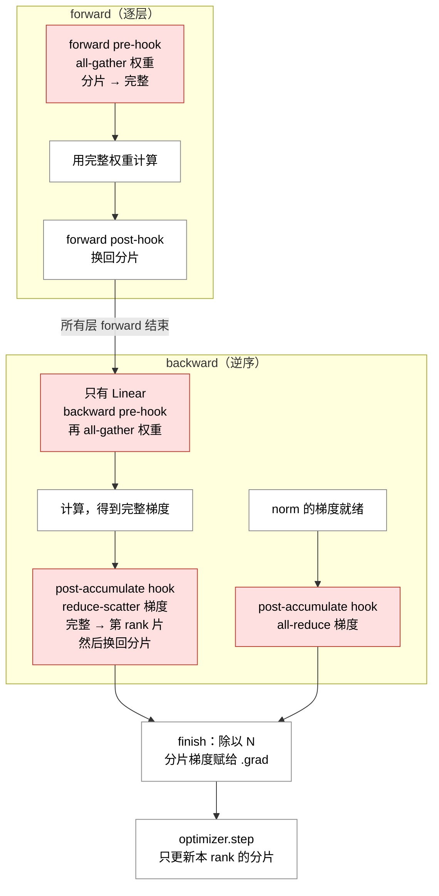
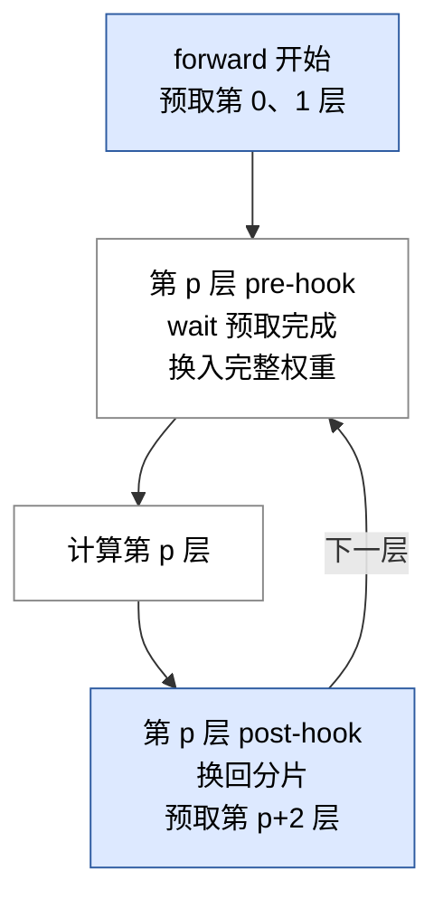

# DDP、Sharded Optimizer、FSDP 的通信操作汇总

> 对应讲义第 5–7 章和 `cs336_systems/` 下的实现。这里只记录通信：什么时候发起、通信什么、同步还是异步、在哪里 wait。
>
> 相关笔记：[数据并行的逐步优化](数据并行的逐步优化.md)、[DDP 的 sync 和 async 机制](DDP的sync和async机制.md)（有时间线）、[FSDP 的四种实现](FSDP的四种实现Basic_Async_Prefetch_MixedPrecision.md)（有时间线和预取细节）
>
> 流程图图例：红色 = 同步通信，蓝色 = 异步通信，白色 = 本地操作（不通信），虚线框 = 由 DDP 负责的通信。

---

## 0. 四种集合操作

N = rank 数，S = 完整张量的字节数，W = 每个设备的出口带宽。耗时按讲义 §8.1（p.40–41）的 ring 算法计算。

| 操作 | 每个 rank 的输入 → 输出 | ring 耗时 | 用在哪 |
|---|---|---|---|
| broadcast | src 的完整张量 → 每个 rank 都得到一份 | 讲义没有给出 | 构造时同步初始参数；sharded optimizer 每次 step 之后 |
| all-reduce | 完整张量 → 所有 rank 求和后的完整张量 | 2(N−1)/N · S/W | DDP 的梯度；FSDP 中 norm 的梯度 |
| all-gather | 自己那片（S/N）→ 拼好的完整张量（S） | (N−1)/N · S/W | FSDP 中拼完整权重 |
| reduce-scatter | 完整张量（S）→ 求和结果中的第 rank 片（S/N） | (N−1)/N · S/W | FSDP 中的权重梯度 |

两条通用规则：

1. **按调用顺序配对**：集合操作要求所有 rank 都调用，各 rank 的第 k 次调用彼此配对。因此各 rank 发起通信的顺序必须完全一致，否则会卡住，或者配错数据。
2. **异步的约束**：`async_op=True` 会立刻返回 handle。wait 之前，不能读写参与通信的张量，也必须一直持有它们的引用。Gloo 的 wait 会阻塞 CPU；NCCL 的 wait 只让计算 stream 等待通信 stream。

---

## 1. 总览：一步训练中的通信

| 方案 | 构造时 | forward | backward | finish | step |
|---|---|---|---|---|---|
| DDP naive | broadcast 参数和 buffer | — | — | 每个参数 all-reduce 一次，同步 | — |
| DDP flat | 同上 | — | — | all-reduce 一次，同步 | — |
| DDP overlap | 同上 | — | 每个参数 all-reduce 一次，异步 | wait | — |
| Sharded optimizer | — | — | 由 DDP 负责 | 由 DDP 负责 | 每个参数 broadcast 一次，同步 |
| FSDP | broadcast 参数 | 每个切分层 all-gather，同步 | all-gather（只有 Linear）、reduce-scatter、all-reduce（norm），都是同步 | — | — |
| AsyncFSDP | 同上 | 同上 | all-gather 同步；reduce-scatter、all-reduce 异步 | wait | — |
| PrefetchFSDP | 同上 | all-gather 提前两层异步发起 | 同 AsyncFSDP | wait | — |
| MixedPrecisionFSDP | 同上 | 同 PrefetchFSDP，按 compute_dtype 通信 | 同 AsyncFSDP；all-gather 按 compute_dtype，reduce-scatter 按 FP32 | wait | — |

另外，FSDP 测试中调用的 `gather_full_params` 会对每个切分参数做一次同步 all-gather（FP32）。

---

## 2. DDP（`naive_ddp.py`、`flat_gradient_ddp.py`、`overlap_ddp.py`）

| 版本 | 发起位置 | 每步次数 | 每次的张量 | 同步 / 异步 |
|---|---|---|---|---|
| naive | `finish_gradient_synchronization` | requires_grad 参数的个数 | 一个参数的梯度 | 同步 |
| flat | `finish_gradient_synchronization` | 1 | 全部梯度拼成的一维缓冲区 | 同步 |
| overlap | 每个参数的 post-accumulate-grad hook | requires_grad 参数的个数 | 一个参数的梯度 | 异步，在 `finish` 里 wait |

- 三个版本传输的总字节数相同，都是全部梯度。区别只在调用次数（flat 省掉了每次调用的固定开销）和发起时机（overlap 让通信和 backward 重叠）。
- overlap 在 all-reduce 之前先除以 N，所以求和的结果直接就是平均值。wait 之前 `.grad` 的值还不确定，不能使用。
- 参数只在构造时广播一次，之后不再通信：各 rank 起点相同，每步又用同一份平均梯度更新，所以始终保持一致。
- 顺序一致：naive 按 `parameters()` 的顺序逐个调用；flat 只调用一次；overlap 按 hook 的触发顺序调用，而触发顺序由计算图决定，各 rank 相同。

---

## 3. Sharded Optimizer（`sharded_optimizer.py`）

构造时**没有通信**：每个 rank 各自用规则 B（`load_balance_assign_rank`，按元素个数贪心分配）算出“参数 → 负责的 rank”表。各 rank 的参数顺序和大小都相同，所以算出的表也相同。这是 step 中 broadcast 能正确配对的前提：同一个参数的 src 在所有 rank 上必须一致。

以 2 个 rank、4 个参数为例（rank 0 负责 P1、P3，rank 1 负责 P2、P4）：

| 通信 | 发起位置 | 每步次数 | 每次的张量 | 同步 / 异步 |
|---|---|---|---|---|
| broadcast | `step`，在内层 step 之后 | 交给优化器的参数个数 | 一个参数的 `.data` | 同步 |

- 每个参数广播一次，所以一步要传输全部参数；每个 rank 发出自己负责的部分，接收其余的部分。
- 同步调用：先做完 step 的 rank 会停在第一次 broadcast 上，等待 step 最慢的 rank。
- `requires_grad=False` 的参数也在表里，同样会被广播，只是值没有变。
- 测试中没有套用 DDP：各 rank 用同一个种子生成同一份输入，梯度本来就相同，所以测试中唯一的通信就是这些 broadcast。
- 和 ZeRO stage 1 比较通信量，是 `optimizer_state_sharding_accounting (c)` 的问题，留给自己分析。

---

## 4. FSDP（`fully_sharded_data_parallel_training.py`）

构造时，rank 0 先把全部参数 **broadcast** 出去（同步，不含 buffer）。这一步在切分之前，保证各 rank 是从同一个完整张量中切出自己那片。之后每个 rank 在本地取第 rank 片（不通信），然后注册 hook。只有 Linear 和 Embedding 的权重会切分，norm 不切分。

### 4.1 基础版：一步中的通信

后面三个版本只改变图中某些通信的同步方式或 dtype：

| 通信 | 发起位置 | FSDP | AsyncFSDP | PrefetchFSDP | MixedPrecisionFSDP |
|---|---|---|---|---|---|
| forward 的 all-gather | `gather_weight_pre_hook`；从 Prefetch 起改由 `start_prefetch` 提前发起 | 同步 | 同步 | 第 1 次迭代同步；之后异步，提前两层发起 | 同 Prefetch，按 compute_dtype |
| backward 的 all-gather（只有 Linear） | `gather_weight_pre_hook`，作为 backward pre-hook | 同步 | 同步 | 同步 | 同步，按 compute_dtype |
| 权重梯度的 reduce-scatter | `backward_post_hook` → `reduce_scatter_grad` | 同步 | 异步，在 `finish` 里 wait | 异步 | 异步，梯度先转成 FP32 |
| norm 梯度的 all-reduce | `unsharded_grad_hook` → `all_reduce_grad` | 同步 | 异步，在 `finish` 里 wait | 异步 | 异步，FP32 |
| 测试用的 all-gather | `gather_full_params` | 同步 | 同步 | 同步 | 同步，FP32 |

### 4.2 PrefetchFSDP 的 forward

第一次迭代不预取：所有层都是同步 all-gather，同时记录各层的执行顺序。从第二次迭代起：

### 4.3 每步的调用次数

以 `BasicsTransformerLM`（L 个 block）为例。L = 2 时实测为 16 / 15 / 16 / 5。

| 通信 | 次数 | 来源 |
|---|---|---|
| forward 的 all-gather | 7L + 2 | 每个 block 有 7 个 Linear（q、k、v、output、w1、w2、w3），再加上 embedding 和 lm_head |
| backward 的 all-gather | 7L + 1 | 同上，但不含 embedding |
| reduce-scatter | 7L + 2 | 每个切分权重一次 |
| all-reduce | 2L + 1 | 每个 block 有两个 RMSNorm，再加上 ln_final |

- 顺序一致：所有通信都在 hook 中发起，hook 的触发顺序由模型和计算图决定；预取的发起点（forward 开始时、第 p 层结束时）也是确定的。
- 异步张量的引用：`AsyncFSDP` 把完整梯度存进 `ongoing_communication_params`，因为 hook 紧接着会把 `.grad` 设为 None；`PrefetchFSDP` 把缓冲区和 handle 存进 `prefetch_dict`，wait 之后才换进 `weight.data`。
- 混合精度只改变通信的 dtype：all-gather 的字节数减半；reduce-scatter 和 norm 的 all-reduce 仍然是 FP32，字节数不变。
- `finish` 不发起新的通信，只做 wait、除以 N 和赋值。

### 4.4 实测：Linear 在 backward 中的 all-gather 实际起什么作用

用 2 层模型和基础版 FSDP 实测（后三个版本的换入、换出逻辑相同）：

- **forward 之后，Linear 的完整权重并没有被释放。** einsum 内部会把权重变形成一个视图（形状为 `(1, d_in, d_out)`）交给 bmm。autograd 为 backward 保存的就是这个视图，它指向 forward 时 gather 出的缓冲区。forward 结束时，全部 15 个 Linear 的完整权重都还被 autograd 引用着。Embedding 只保存了 token 索引，它的完整权重确实被释放了。
- **backward 计算梯度用的是这份保存下来的缓冲区，不是 backward pre-hook 新 gather 出的那一份。** 把 backward 中 all-gather 的结果换成全 0，所有梯度都完全不变。
- **但这次 all-gather 也不能直接去掉**：它让 `weight.data` 恢复成完整形状。Linear 的权重梯度是转置布局，梯度累加时会按参数当前的形状和布局重新拷贝一份；如果参数这时是分片形状，就会报 size mismatch。Embedding 的梯度布局和参数一致，会被直接收下，所以不需要这一步。
- 讲义 p.39 要求 "Make sure to free the gathered weights after use"。按现在的实现，forward 期间每个 Linear 的完整权重会一直保留到它自己的 backward，估算峰值显存时要把这一点算进去。

---

## 5. 一句话总结

- **DDP**：每步只对梯度做 all-reduce；参数在构造之后不再通信。
- **Sharded optimizer**：在 DDP 的基础上，每次 step 之后再加一轮参数 broadcast。
- **FSDP**：梯度只做 reduce-scatter；权重在使用前 all-gather，forward 一次，Linear 的 backward 再一次；只有不切分的 norm 还做完整的 all-reduce。
