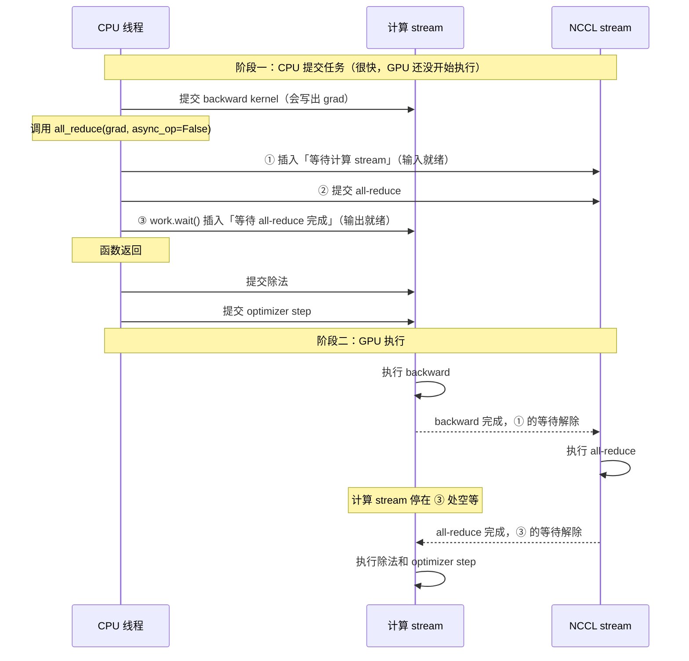
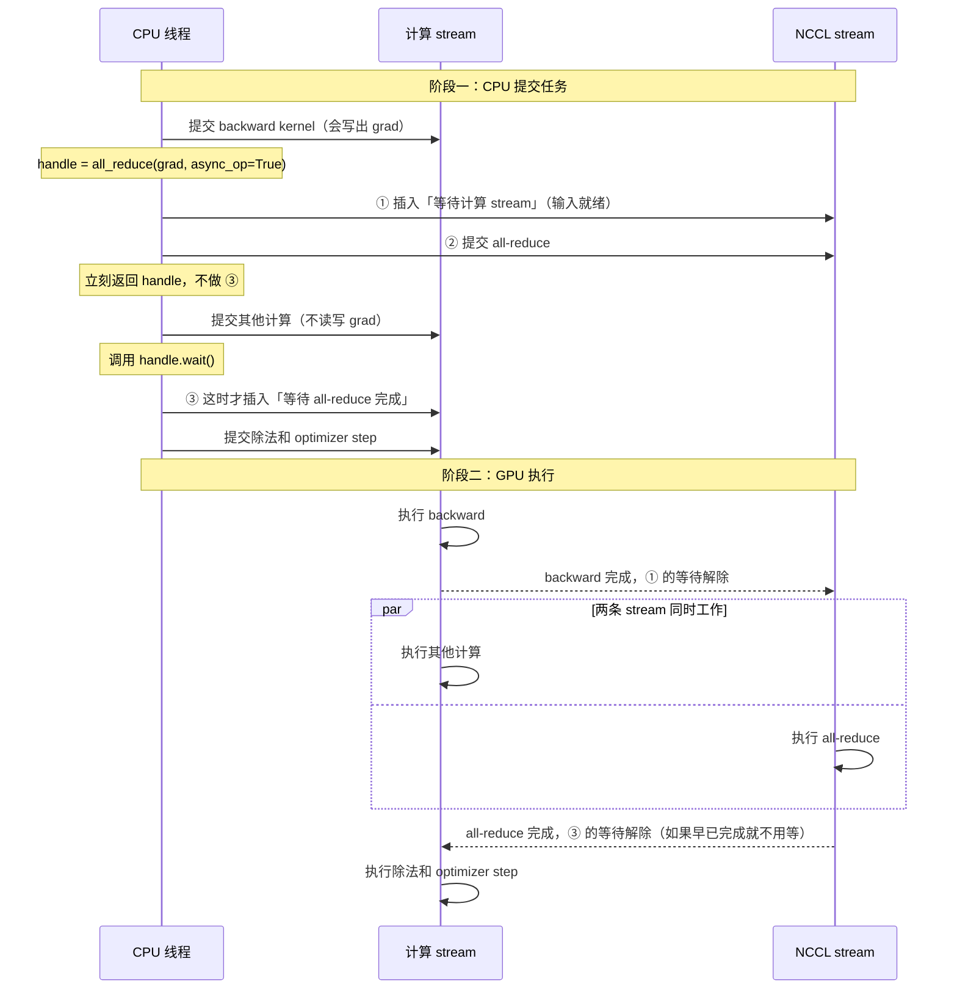
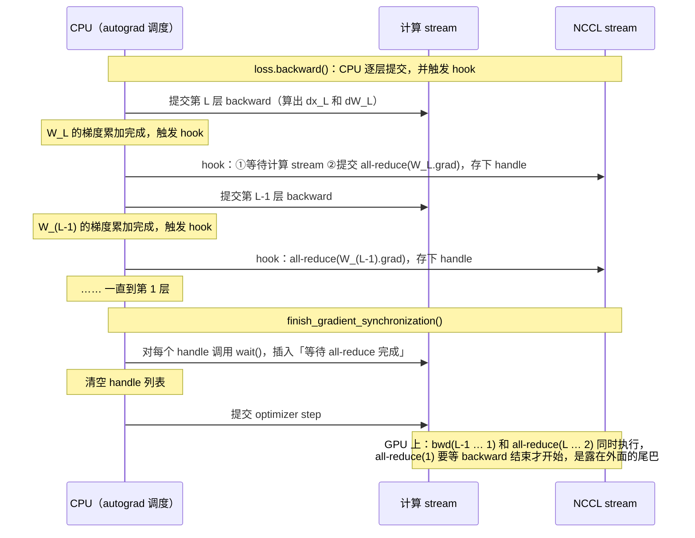

# 5.3.2 通信与计算重叠：同步 vs 异步 all-reduce 详解

> 对应讲义 §5.3.2 (p.34–36)。这篇笔记要讲清楚四件事：为什么要让通信和计算重叠；`async_op=False` 和 `async_op=True` 在 GPU 上分别发生了什么；backward hook 在什么时候触发；naive、flat、overlap 三种 DDP 在一步训练里的时序有什么区别。
>
> 文中标注“实验验证”的结论，都在本机 torch 2.11 上实际运行确认过。
>
> 文中的 Mermaid 时序图需要支持 Mermaid 的 Markdown 预览才能显示（GitHub、VS Code，或者开启了 Mermaid 扩展的 JetBrains）。每张 Mermaid 图后面都附有等价的文本时间线。

---

## 0. 时间线图的符号说明

| 符号 | 含义 |
|---|---|
| `CPU` | 负责提交任务的 CPU 线程 |
| `compute` | 计算 stream：PyTorch 默认把计算 kernel 提交到这里 |
| `NCCL` | NCCL 内部使用的通信 stream |
| `main` / `gloo` | 本地 Gloo 环境中的 CPU 主线程，以及 Gloo 后台通信线程 |
| `F` | forward |
| `B4 … B1` | 第 4 层到第 1 层的 backward（第 4 层最靠近 loss） |
| `A4 … A1`、`AR4 … AR1` | 第 4 层到第 1 层**参数梯度**的 all-reduce |
| `AR` | all-reduce |
| `div` | 梯度除以进程数（求平均） |
| `opt` | optimizer step |
| `....` | 空闲：stream 停在等待指令上什么也不做 |

时间线是示意图，每个字符代表一个时间单位，长度不按真实比例。

---

## 1. 一句话总结

- **naive 和 flat**：等 backward 全部结束才开始通信。通信期间计算单元闲着，所以通信时间会完整地加到每一步上。
- **overlap**：backward 还在进行时，每个参数的梯度一写进 `.grad`，hook 就立刻对它发起**异步** all-reduce，后面几层的 backward 和这些通信同时进行。等到 `finish_gradient_synchronization` 时，再对所有通信统一 `wait()`。
- **通信本身并没有变快**，同样的字节数、同样的带宽。减少的是“暴露在外”的通信时间，也就是计算停下来等通信的那部分。
- **区别全在一个开关上**：
  - `async_op=False`：发起通信，然后立刻 `wait()`。
  - `async_op=True`：只发起通信，`wait()` 推迟到你自己调用的时候。
  - `wait()` 本身在两种后端上含义不同：用 NCCL 时，它在计算 stream 里插入一条“等通信完成”的指令；用 Gloo 时，它让 CPU 线程停下来等。

---

## 2. 动机：naive DDP 的两个问题

讲义 p.34 指出了 5.2 里 naive DDP 的两个局限：

1. 每个参数张量单独做一次 all-reduce。每次调用都有固定开销。
2. 要等 backward 全部结束才开始通信。可是 backward 是反向逐层算出梯度的，一个梯度一算完，其实就可以马上发出去。通信操作和继续计算操作可以并行

5.3.1 和 5.3.2 分别解决这两个问题：

| 实现 | 通信调用次数 | 通信与 backward 的关系 | 减少的是什么 |
|---|---|---|---|
| naive (5.2) | 每个参数一次（xl 是 291 次） | 串行：backward 结束后才开始 | — |
| flat (5.3.1) | 1 次 | 串行 | 每次调用的固定开销 |
| overlap (5.3.2) | 每个参数一次 | 重叠：边算边传 | 暴露在外的通信时间 |

这里要分清两个量：

- **通信本身的耗时**：由字节数和带宽决定。flat 省掉的是其中的固定开销部分，传的字节数一点没少。
- **通信让一步训练变慢了多少**：也就是计算停下来等通信的时间。讲义 p.34 说，就算把梯度拼平了，"all the communication time still directly contributes to the overhead"（全部通信时间仍然直接计入开销）。5.3.2 要减少的就是这个量。

---

## 3. 为什么能重叠：依赖分析

以讲义 p.41 FFN 的最后一层为例。forward 是 y = z·W₃，backward 时这一层会产生两个输出，两者去向不同：

| 输出 | 公式 | 去向 |
|---|---|---|
| 激活梯度 | dz = dy·W₃ᵀ（式 24） | 传给前一层，前一层要用它继续往前算 |
| 参数梯度 | dW₃ = zᵀ·dy（式 28） | 累加进 `W₃.grad`，触发 hook，然后交给 all-reduce |

```text
                  +---- dx_L ----> 第 L-1 层 backward ---> ... ---> 第 1 层 backward
dy_L ---> 第 L 层 backward
                  +---- dW_L ----> W_L.grad ---> all-reduce(W_L.grad) ---> (finish 时 wait) ---> optimizer
```

- 两条路都从同一个 dy 出发，分开之后就互不依赖：前面几层的 backward 只用 dx，不用 dW_L；all-reduce 只用 dW_L，不用 dx。
- all-reduce 会原地修改 `W_L.grad`，但剩下的 backward 根本不读它，所以不会冲突。
- **参数的值在整个过程中不会变**：算 dx 时用到了 W_L 的值，但这一步在第 L 层的 backward 里就做完了；参数要到 optimizer step 才更新，而 optimizer step 要等所有通信都结束。
- **共享权重要多想一步**：如果 W 被两层共用，`W.grad` 要累加两份梯度。必须等两份都加完才能开始通信，所以要用“累加完成之后”才触发的 hook（见第 7 节）。

结论：**第 L 层参数梯度的 all-reduce（通信）和第 L-1 层到第 1 层的 backward（计算）可以同时进行。**

---

## 4. 预备知识：stream、event，以及 CPU 提交与 GPU 执行

### 4.1 stream

- stream 是 GPU 上的一条**任务队列**。CPU 往里面提交任务后立刻返回，GPU 按提交顺序依次执行。
- 同一条 stream 里的任务**严格按顺序执行**；不同 stream 里的任务**可以同时执行**。
- PyTorch 的计算默认提交到当前 stream，本文称为“计算 stream”。NCCL 的通信在自己内部的另一条 stream 上执行，本文称为“NCCL stream”。正因为两者是不同的 stream，通信和计算才有可能同时进行。

### 4.2 event：让一条 stream 等另一条

CUDA 用 event 建立跨 stream 的依赖：

1. 在 stream A 上记录一个 event，相当于在队列里放一个标记：“执行到这里，前面的任务就都完成了”。
2. 在 stream B 上插入一条“等待这个 event”的指令。
3. stream B 执行到这条指令时会停下来，直到 stream A 执行到那个标记，才继续往下执行。

这种等待**完全发生在 GPU 上，CPU 不会被阻塞**。

### 4.3 CPU 提交与 GPU 执行是异步的

- CPU 调用 PyTorch 的计算函数时，只是把 kernel 提交进队列就返回了。CPU 通常跑在 GPU 前面。
- 如果要让 CPU 等 GPU 执行完，需要调用 `torch.cuda.synchronize()`。benchmark 用 CPU 计时器计时时，就必须这样做，否则测到的只是“提交任务”花的时间。
- 在 CPU 上读取结果（`print`、`.item()`、`.cpu()`）时会隐式地等待，所以读到的结果是对的。

### 4.4 换成 Gloo + CPU 时的对应关系

| 概念 | NCCL + GPU | Gloo + CPU（本地 Mac） |
|---|---|---|
| 谁做计算 | 计算 stream | CPU 主线程（autograd 引擎） |
| 谁做通信 | NCCL stream（走 NVLink） | Gloo 后台线程 |
| “等待”是什么 | GPU 上的一条等待指令，CPU 不阻塞 | CPU 线程阻塞 |

---

## 5. 同步 all-reduce (`async_op=False`) 的完整时序

### 5.1 源码层面：同步 = 异步 + 立刻 wait

torch 2.11 的 `dist.all_reduce` 内部做的事（实验验证，读了 `distributed_c10d.py`）：先发起通信，得到一个 work 对象。如果 `async_op=True`，直接把 work 当作 handle 返回；否则，在返回之前先调用一次 `work.wait()`，然后返回 None。

> `async_op=False` 等价于 `async_op=True` 再立刻调用 `handle.wait()`。

### 5.2 用 NCCL 时，一次同步 all-reduce 在 CPU 上做的三件事

| 步骤 | 做什么 | 目的 | 受 `async_op` 控制吗 |
|---|---|---|---|
| ① | 让 NCCL stream 等计算 stream | **输入就绪**：等前面的 backward 把 grad 写完，通信才开始读 | 不受控制，同步和异步都会做 |
| ② | 把 all-reduce 提交到 NCCL stream | 真正的通信 | — |
| ③ | `work.wait()`：让计算 stream 等 all-reduce 完成 | **输出就绪**：之后提交的计算一定读到求和后的结果 | 受控制。同步时立刻插入；异步时要等你调用 `wait()` 才插入 |

三件事做完函数就返回了。**这时 GPU 上的通信可能还没开始。**

### 5.3 例子：backward → 同步 all-reduce → 除以进程数 → optimizer



等价的文本时间线：

```text
CPU     : [提交bwd][发起AR: ①②③][提交div][提交opt]   （之后 CPU 空闲）

t       : 0         10        20        30
compute : [bwd=====]..........[div][opt=]
NCCL    :           [AR======]
                    ^         ^
                    |         `-- ③ 解除：AR 完成，计算 stream 继续执行 div
                    `-- ① 解除：bwd 写完 grad，AR 开始
```

### 5.4 "later function calls using the output will behave as expected" 是什么意思

讲义 p.35 说，同步调用 "will block until the collective operation is queued on the GPU"（会一直阻塞，直到集合操作被排进 GPU 队列），并且 "later function calls using the output will behave as expected"（之后使用这个输出的操作都会正常工作）。

原因在于：除法 kernel 排在 ③ 那条等待指令后面，而同一条 stream 必须按顺序执行，所以除法只能在 all-reduce 完成后才开始。optimizer step 也提交在同一条 stream 上，同样排在通信之后。写代码的人不需要做任何额外处理，顺序自动就是对的。

但这个保证**只对提交到同一条计算 stream 上的操作有效**。如果你自己另建了 stream，就需要自己插入等待，这就是讲义脚注 5 讲的内容。

### 5.5 换成 Gloo + CPU

同步调用会让 CPU 线程一直阻塞，直到 Gloo 把通信真正做完才返回。这时的“等待”是 CPU 停住了，而不是 GPU 队列里多了一条指令。

---

## 6. 异步 all-reduce (`async_op=True`) 的完整时序

### 6.1 和同步只差一步

①、② 和同步完全一样。**③ 不做**，函数立刻返回一个 handle（Work 对象）。

- `handle.wait()`：直到这时才执行 ③，把等待指令插进计算 stream，位置就在你调用 `wait()` 的这个时刻。
- `handle.is_completed()`：查询这次通信是否已经完成。
- **handle 一定要存下来**。它代表一次还在进行中的通信，以后只能通过它来等待。

讲义 p.35 的说法比较保守：异步调用返回时，"is not guaranteed to have been queued on the GPU, let alone completed"（连有没有排进 GPU 队列都不保证，更别说完成了），所以在 `wait()` 之前不能依赖它的结果。实际上 NCCL 会立刻在自己的 stream 上开始通信。真正的区别是：**异步调用不会让计算 stream 等它。**

### 6.2 例子：在发起和等待之间，插入一段不依赖 grad 的计算



计算 stream 走到 ③ 时，分两种情况。

**情况 A：其他计算比 all-reduce 长，通信被完全藏住**

```text
t       : 0         10        20        30
compute : [bwd=====][other=======][div][opt=]
NCCL    :           [AR======]
                              ^   ^
                              |   `-- wait() 插入的位置：AR 早已完成，不用等
                              `-- AR 完成
```

**情况 B：其他计算比 all-reduce 短，只藏住了一部分**

```text
t       : 0         10        20        30
compute : [bwd=====][oth].....[div][opt=]
NCCL    :           [AR======]
                        ^     ^
                        |     `-- AR 完成，等待解除，执行 div
                        `-- wait() 插入的位置：AR 还没完成，计算 stream 空等
```

### 6.3 规则：从发起到 wait 这段时间里，不要读写这个张量

在 `wait()` 之前提交的计算，前面没有任何等待指令挡着。如果它碰了正在通信的张量，就会产生数据竞争：

```text
t       : 0         10        20        30
compute : [bwd=====][div][opt=]
NCCL    :           [AR======]
                    ^^^^^
                    `-- div 和 AR 同时读写 grad：数据竞争，结果时对时错
```

求平均有两个安全的时机：

| 时机 | 为什么安全 |
|---|---|
| **发起通信之前**就除 | 除法提交在计算 stream 上；① 让 NCCL 先等计算 stream，所以通信会等除法做完再读 grad |
| **`wait()` 之后**再除 | 除法排在 ③ 后面，一定在通信完成后才执行 |

**最危险的写法**：在 hook 里发起通信之后，紧接着就做除法。

### 6.4 换成 Gloo + CPU

- 发起异步 all-reduce：把通信任务交给 Gloo 后台线程，主线程立刻返回，接着计算。
- `wait()`：主线程停下来，等后台线程把这次通信做完。
- 数据竞争的道理完全一样：如果主线程在 `wait()` 之前修改张量，而后台线程同时在读写它，结果就会出错。

---

## 7. backward hook：什么时候触发、拿到什么

### 7.1 `register_post_accumulate_grad_hook` 的触发时机

- 在 autograd 的计算图里，参数是**叶子节点**，每个参数都对应一个 AccumulateGrad 节点。
- backward 走到这个节点时，会把传进来的梯度加进 `.grad`（`.grad` 为 None 时直接创建），**加完之后**才调用 post-accumulate hook。
- 调用 hook 时传进来的是**参数本身**，hook 不需要返回值。在 hook 里读 `param.grad`，拿到的就是这一次 backward 的完整梯度，在剩下的 backward 里它不会再被修改。
- hook 注册一次后会一直挂在参数上，以后每次 backward 都会触发。

### 7.2 触发顺序和次数（实验验证）

用和 `tests/common.py` 里 `ToyModelWithTiedWeights` 相同的结构做实验。它的 forward 顺序是 fc1 → fc5，其中 fc4 和 fc2 共享同一份权重。hook 的实际触发顺序是：

```text
fc5.weight  ->  fc3.weight  ->  fc2.weight（与 fc4 共享）  ->  fc1.weight
```

- 顺序和 forward **相反**：越靠近 loss 的层越早触发。
- 共享权重**只触发一次**，而且排在 fc3 之后。原因是它要等两处使用产生的梯度都累加完。具体机制是：两份梯度先在节点入口处相加，AccumulateGrad 节点只执行一次。
- 只要计算图结构相同，触发顺序就是确定的。所以**各 rank 发起 all-reduce 的顺序也一致**，这是所有集合操作都必须满足的前提。

### 7.3 冻结参数不能注册（实验验证）

对 `requires_grad=False` 的参数注册这个 hook，会直接报错：

```text
RuntimeError: cannot register a hook on a tensor that doesn't require gradient
```

`ToyModel` 里有两个冻结参数：`fc2.fc.bias` 和 `no_grad_fixed_param`。如果注册时不跳过它们，DDP 一构造就会崩。

### 7.4 hook 在 CPU 上触发时，GPU 可能还没算完这个梯度

hook 是在 autograd 引擎于 CPU 上处理到 AccumulateGrad 节点时被调用的。这时，算这个梯度的 kernel 可能才刚被提交，GPU 还没执行完。之所以仍然正确，靠的就是第 5.2 节的 ①：NCCL 发起通信时会让 NCCL stream 先等计算 stream，所以通信一定读到算完的梯度。

### 7.5 三种 hook 对比

| hook | 注册在哪 | 什么时候触发 | 收到什么 | 适合 DDP 吗 |
|---|---|---|---|---|
| `Tensor.register_hook` | 任意张量 | 这个张量的梯度刚算出来时，还没写进 `.grad` | 梯度本身（可以返回一个替换值） | 太早：hook 返回后，autograd 还要用这个梯度更新 `.grad`。如果此时已经对它发起了异步通信，两者就会同时读写 |
| `Tensor.register_post_accumulate_grad_hook` | 叶子张量（参数） | 梯度写进 `.grad` 之后 | 参数本身 | **合适** |
| `Module.register_full_backward_hook` | 模块 | 模块输入的梯度算出来时 | 模块输入和输出的梯度 | 不合适：拿到的是激活梯度，不是参数梯度 |

---

## 8. 同步 vs 异步：逐项对比（重点）

| 对比项 | 同步 `async_op=False` | 异步 `async_op=True` |
|---|---|---|
| 返回值 | None | handle（Work 对象） |
| 什么时候返回 | NCCL：①②③ 都提交完就返回；Gloo：通信真正完成后才返回 | ①② 提交完立刻返回 |
| 计算 stream 里的等待指令（③） | 立刻插入，紧跟在 all-reduce 后面 | 推迟到调用 `wait()` 时插入 |
| CPU 是否阻塞 | NCCL：不阻塞；Gloo：阻塞到通信完成 | 发起时都不阻塞；调用 `wait()` 时，Gloo 阻塞、NCCL 不阻塞 |
| 之后的计算能否和通信同时进行 | 不能。NCCL 下被等待指令挡住，Gloo 下 CPU 被阻塞 | 能，一直到调用 `wait()` 为止 |
| 结果什么时候可以用 | 函数返回后 | `wait()` 之后 |
| 主要风险 | 没有数据竞争，但也没有重叠 | `wait()` 之前读写张量会产生数据竞争；忘记 `wait()` 或忘记清空 handle 列表 |

### 8.1 为什么在 hook 里用同步调用就没有重叠

两种后端都会失去重叠，只是原因不同：

- **NCCL**：同步调用不阻塞 CPU，但每次都会立刻插入 ③。于是计算 stream 在每个 all-reduce 后面都要停下来等，后面层的 backward 只能排队。
- **Gloo**：同步调用直接阻塞 CPU 主线程，而 backward 的计算也在这个线程上。于是 backward 每算完一层，都要停下来等这一层的通信做完。

hook 里用同步调用（或者在 hook 里调用 `wait()`）：

```text
compute : [F=====][B4==]....[B3==]....[B2==]....[B1==]....[opt=]
NCCL    :               [A4]      [A3]      [A2]      [A1]
```

hook 里用异步调用，等到 finish 时再统一 `wait()`：

```text
compute : [F=====][B4==][B3==][B2==][B1==]....[opt=]
NCCL    :               [A4]  [A3]  [A2]  [A1]
```

两张图的通信总量完全一样，区别只在于等待指令插在哪里。

---

## 9. 放进 DDP：naive、flat、overlap 一步训练的时序对比

### 9.1 overlap DDP 一步训练的时序图



### 9.2 三种实现的文本时间线（以 4 层为例）

**naive (5.2)**：backward 结束后，逐个参数做同步 all-reduce，每次调用之间有固定开销（空隙）

```text
compute : [F=====][B4==][B3==][B2==][B1==]....................[opt=]
NCCL    :                                  [A4] [A3] [A2] [A1]
```

**flat (5.3.1)**：backward 结束后，把梯度拼平，只做一次 all-reduce

```text
compute : [F=====][B4==][B3==][B2==][B1==].................[opt=]
NCCL    :                                  [AR(all)=======]
```

> 这张图省略了拼平和写回的拷贝时间。这部分拷贝是 flat 额外付出的代价，实际能不能比 naive 快，取决于省下的调用开销和多出的拷贝开销谁更大。

**overlap (5.3.2)**：hook 里发起异步 all-reduce，finish 时统一 `wait()`

```text
compute : [F=====][B4==][B3==][B2==][B1==]....[opt=]
NCCL    :               [A4]  [A3]  [A2]  [A1]
```

### 9.3 粗略的时间公式

- **naive**：forward + backward + 全部通信（每次调用都有固定开销） + optimizer
- **flat**：forward + backward + 一次大通信 + 拼平和写回的拷贝 + optimizer
- **overlap**：forward + backward + **没能藏住的那部分通信** + optimizer

---

## 10. 能藏住多少通信

- **backward 的计算远比通信长**：每一层的通信都能在后面几层的计算期间完成。最后只剩“最后一个算出的梯度”的通信露在外面，也就是最靠近输入的那一层，比如 embedding。见 9.2 的 overlap 图。
- **通信比计算还长**：通信会越积越多，backward 结束时还有一大串没做完。暴露的时间大约等于通信总时间减去能重叠的那部分计算时间：

```text
compute : [F=====][B4][B3][B2][B1].............[opt=]
NCCL    :             [AR4=][AR3=][AR2=][AR1=]
```

- **forward 和 optimizer step 期间的时间藏不住**：forward 时梯度还不存在；optimizer step 必须等所有通信完成之后才能开始。
- 讲义 §8.2 (p.42) 分析数据并行时也用了这个思路："Because computation and communication can be overlapped, we are bottlenecked when communication time becomes larger than computation time."（计算和通信可以重叠，所以只有当通信时间超过计算时间时，通信才会成为瓶颈。）

> 思考：结合 5.2 里对 xl 模型（FP32，2 张卡用 NVLink 连接）的估算，backward 大约要多少时间，梯度通信大约要多少时间？overlap 能把通信藏住多少？

---

## 11. 实现要点清单（不含代码）

**构造函数**

- 先调用父类的构造函数，再把被包装的模型保存为 `module` 属性。
- 广播所有参数和 buffer，做法和 naive 版一样，包括冻结参数。
- 准备一个用来存放 handle 的列表。
- 遍历 `self.module.parameters()` 注册 hook。这个方法会自动去重，共享权重只注册一次；如果同一个张量注册了两次 hook，就会被同时发起两次异步通信，产生数据竞争。
- 只给 `requires_grad=True` 的参数注册，否则会报 RuntimeError（见 7.3）。
- 在 hook 里使用传进来的参数，不要在循环里用闭包捕获循环变量。Python 闭包是晚绑定的，那样写的话，所有 hook 最后都会指向最后一个参数。

**hook**

- 对 `param.grad` 发起 `async_op=True` 的 all-reduce，并把 handle 存进列表。
- **不要在 hook 里调用 `wait()`**，否则又退化成了同步，见 8.1。
- **发起之后不要再修改这个 `.grad`**，见 6.3。

**求平均**：选一个安全的时机，要么在发起通信之前除，要么在 `wait()` 之后除，见 6.3。

**`finish_gradient_synchronization`**

- 对列表里的每个 handle 调用 `wait()`。
- 如果选择在 `wait()` 之后求平均，就在这里做除法。
- **最后清空列表**。如果不清空，下一步会把旧的 handle 再等一遍；如果你是遍历保存下来的参数来做除法，旧参数还会被再除一遍。

**adapter**：`get_ddp` 返回新的类；`ddp_on_after_backward` 调用 `finish_gradient_synchronization`。这一处不用改。

**验证**

- `uv run pytest tests/test_ddp.py` 连续跑 5 次。数据竞争这类 bug 时有时无，多跑几次才容易暴露。
- 用 `torch.equal` 检查各 rank 的参数和梯度是否逐位相同。这比测试里用的 `allclose` 更严格。
- 在 hook 里记录触发顺序，并在 `loss.backward()` 返回之后打一个标记。你应该看到：所有通信都是在 backward 返回之前发起的，而且顺序是从最后一层到第一层。测试本身检查不到这一点。

---

## 12. 常见错误与对应现象

| 现象 | 可能原因 |
|---|---|
| 构造时报 `RuntimeError: cannot register a hook on a tensor that doesn't require gradient` | 给冻结参数注册了 hook |
| 测试时有时通过、有时失败 | 发起通信之后、`wait()` 之前修改了 `.grad`（比如在 hook 里紧接着做除法）；或者同一个参数注册了两次 hook |
| 测试卡住不动 | 各 rank 发起通信的次数或顺序不一致，比如计算图在不同 rank 上不一样 |
| 结果正确，但完全没有提速 | hook 里用了同步调用，或者在 hook 里调用了 `wait()`；在本地 CPU 上，也可能只是因为计算和通信在抢同一批 CPU 核 |
| 梯度是正确值的若干倍 | 忘了除以进程数，或者在不该除的地方又除了一次 |
| 第一步正确，从第二步开始出错 | finish 里没有清空 handle 列表，导致旧的条目被重复处理 |

---

## 13. 本地 Mac (Gloo + CPU) 与 GPU (NCCL) 的差异

| 对比项 | 本地 Mac (Gloo + CPU) | GPU (NCCL) |
|---|---|---|
| 谁做计算 | CPU 主线程 | 计算 stream |
| 谁做通信 | Gloo 后台线程 | NCCL stream（走 NVLink） |
| 同步调用 | CPU 阻塞到通信完成 | CPU 不阻塞，计算 stream 里被插入等待指令 |
| `wait()` | CPU 阻塞 | 计算 stream 等待，CPU 不阻塞 |
| 重叠的收益 | 有限：计算和通信抢同一批 CPU 核和内存带宽 | 明显：计算单元和 NVLink 基本互不干扰 |
| 正确性测试 | `tests/test_ddp.py` 可以完整运行 | — |
| 计时和 Nsight | 只能用 `torch.profiler` 近似观察 | 讲义要求的环境 |

本地的重叠时间线，结构和 GPU 上一样，只是换了执行者：

```text
main    : [F=====][B4==][B3==][B2==][B1==]....[opt=]
gloo    :               [A4]  [A3]  [A2]  [A1]
```

---

## 14. 计时题要点（需要 GPU）

- **(a)**：只要求报告**每步的总时间**，在 naive、flat、overlap 三种实现之间对比。通信和计算重叠之后，“通信花了多久”和“通信让一步变慢了多久”就不再是同一个数了，所以真正有意义的只剩每步总时间，也就是第 9.3 节里“没能藏住的那部分通信”有多少。
- **(b)**：用 Nsight 截两张图。时间线上，计算 stream 和 NCCL stream 是分开的两行：
  - naive 版：NCCL 那一行的 kernel 全部集中在 backward 结束之后。
  - overlap 版：NCCL 的 kernel 和 backward 的 kernel 在时间上重叠。
- **本地替代**：用 `torch.profiler` 导出 trace，在 Perfetto (ui.perfetto.dev) 里打开，看主线程上的 backward 和 Gloo 线程上的 all-reduce 是否在时间上重叠。

---

## 15. 延伸：分桶，以及 PyTorch 自带 DDP 的做法（了解即可）

- **分桶 (bucketing)**：把 5.3.1 和 5.3.2 结合起来。按 backward 的顺序把梯度分成若干个桶，一个桶里的梯度全部算完，就对这个桶异步做一次 all-reduce。这样调用次数少，又能和计算重叠。PyTorch 自带 DDP 的 `bucket_cap_mb` 默认是 25 MB。这一版讲义没有分桶的题目。
- **`gradient_as_bucket_view`**：让各参数的 `.grad` 本身就是常驻通信缓冲区的视图，省掉拼平和写回的拷贝。
- **自动等待**：PyTorch 自带的 DDP 会在 backward 结束时自动完成等待，用户不需要手动调用 finish。这也是讲义说 `ddp_on_after_backward` 是可选的原因。
- **`find_unused_parameters`**：处理某些参数在部分输入下用不到的情况，这时 hook 的触发次数会和其他 rank 不一致。
- **`no_sync()`**：梯度累积时，前几次 backward 先不通信，只在最后一次 backward 时才通信。本文的实现默认每个 step 只做一次 backward。

---

## 16. 参考

- 讲义 §5.3 (p.34–36)：动机、backward hook、异步通信、推荐接口、计时题
- 讲义 §5.1.1 (p.32) 及脚注 3：GPU 上同步调用的语义，以及 benchmark 时需要 synchronize
- 讲义 §8.1–8.2 (p.40–42)：ring all-reduce 的耗时模型，以及计算与通信重叠时的瓶颈分析
- 课程 lectures 仓库里的 `lecture_07.py`：集合通信与数据并行
- PyTorch 文档（讲义脚注里给出的链接）：
  - [`register_post_accumulate_grad_hook`](https://pytorch.org/docs/stable/generated/torch.Tensor.register_post_accumulate_grad_hook.html)
  - [CUDA semantics (Streams)](https://pytorch.org/docs/stable/notes/cuda.html#cuda-streams)
  - [同步调用的语义讨论](https://github.com/pytorch/pytorch/issues/68112#issuecomment-965932386)
